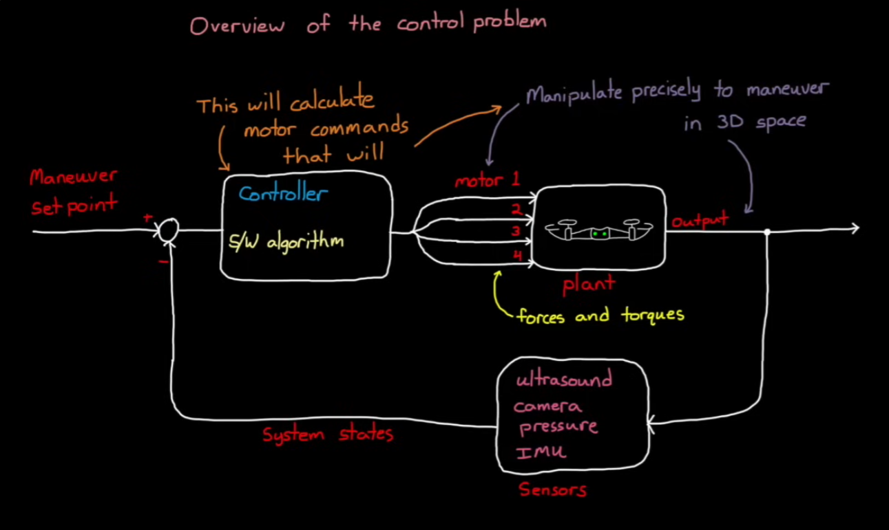

# Study plan for PX4-based Multi-Rotor UAS

## 1. Develop Intuition

The following is an excellent YouTube series (5 videos, ~15 minutes each) to develop a first-principles intuitiion for

* Physics of quadcopters flight
* The need for cascaded control architecture
* Other components that make up a flight control system
  * Sensor models
  * Airframe dynamic model
  * Environment model
  * State estimator
  * Data logging
  * Fault detection and protection
  * Visualisation

**Brian Douglas, [Drone simulation and control](https://youtube.com/playlist?list=PLn8PRpmsu08oOLBVYYIwwN_nvuyUqEjrj&si=4D568flTmtK8odty), 2018**

## 2. Enjoy Instant Gratification

- Setup development environment
- Simulate a quadrotor mission with `px4_sitl`, `QGroundControl` and `Hawkeye`
- Review telemetry data live in `QGroundControl`
- Download logs and replay them in `QGroundControl`: https://docs.qgroundcontrol.com/master/en/qgc-user-guide/analyze_view/
- Replay logs using Hawkeye: https://px4.github.io/Hawkeye/cli

- Follow [SITL](./sitl.md) to setup development environment and simulate quadrotor flight
  - Read logs (ulog files):
    - Use Flight Review, PlotJuggler, and pyulog to plot any uORB topic.
    - Compare setpoints against estimates against actuator outputs.
    - See all about logging and debugging: https://docs.px4.io/main/en/debug/
  - Use the PX4 shell (`pxh>`) while SITL runs:
    - `listener <topic>` to watch live data.
    - `uorb top` to see message rates.
    - `work_queue status` and `perf` to see scheduling and timing.
  - https://docs.px4.io/main/en/sim_sih/
  - https://docs.px4.io/main/en/sim_hawkeye/
  - simulate fail safes: https://docs.px4.io/main/en/simulation/failsafes

## 2. Hello World!

- Write a [Hello World](https://docs.px4.io/main/en/modules/hello_sky) app
  - TODO: create the app here, in a self contained place
  - Write a new uORB topic: https://docs.px4.io/main/en/middleware/uorb
- Write a task: https://docs.px4.io/main/en/modules/module_template
- Write a work queue task: https://docs.px4.io/main/en/modules/module_template
- Read system architecture
  - https://docs.px4.io/main/en/concept/px4_systems_architecture
  - https://docs.px4.io/main/en/concept/architecture
  - https://docs.px4.io/main/en/flight_stack/controller_diagrams
- https://docs.px4.io/main/en/advanced/parameters_and_configurations
- https://docs.px4.io/main/en/concept/events_interface
- https://docs.px4.io/main/en/concept/flight_tasks
- https://docs.px4.io/main/en/concept/control_allocation
- https://docs.px4.io/main/en/concept/system_startup
- uORB pub/sub graph: https://docs.px4.io/main/en/middleware/uorb_graph
- Add a Mavlink message and stream it: https://docs.px4.io/main/en/mavlink/
- Sign a mavlink message
- modules and commands reference: https://docs.px4.io/main/en/modules/modules_main
- inject fault: https://docs.px4.io/main/en/debug/failure_injection
- plot uorb data: https://docs.px4.io/main/en/debug/plotting_realtime_uorb_data
- TODO: pick from advanced topics: https://docs.px4.io/main/en/advanced/
- Write an offboard controller: https://docs.px4.io/main/en/ros/offboard_control
- Harden the mavlink links for security: https://docs.px4.io/main/en/security/
- Become a maintainer. Push our changes: https://docs.px4.io/main/en/contribute/maintainers

## 2. Hands On

- Sign up for GVC and work on it in the backgorund
- Build and fly the dev kit (Holybro X500 v2)

## 3. Develop theoretical basis

PX4 is a pipeline:

> sensors → estimator → controllers → control allocation → actuators

Mission and mode layer (commander, navigator) sits on top and decides what the controllers should be tracking

- **Rigid body dynamics and rotations.**
  - Quaternions, rotation matrices, and Euler angles
  - Frame conventions: NED (world frame), FRD (body frame)
  - Forces and moments
- **Cascaded control.**
  - Position → velocity → attitude → angular rate cascade.
  - Inner loop: rate / attitude stabilization (fastest, closest to motors)
  - Outer loop: position / velocity / altitude control
  - Role of PID in cascaded loops
  - Each loop's bandwidth relative to the next.
  - Motor mixing and command allocation
  - Actuator saturation
  - Why attitude control is separate from position control
- **State estimation.**
  - EKF2: Fusion of IMU, GPS, barometer, magnetometer, optical flow
  - Sensor timing and delay compensation
- **Sensors and signal processing.**
  - IMU noise, vibration (main reason for tuning), aliasing,
  - Low-pass and notch filtering.

### Resources

- Beard and McLain, [Small Unmanned Aircraft: Theory and Practice](https://github.com/byu-magicc/mavsim_public)
- Joan Solà, [Quaternion Kinematics for the Error-State Kalman Filter](https://arxiv.org/abs/1711.02508)
- Chris Rosser, [Ultimate PX4 Tuning Guide](https://youtube.com/playlist?list=PLFPBjpbd5xKRECBsvI3MbmsS8NQJ8l8L9&si=N3wiJo1KoyxyNvKr) (YouTube)
- PX4 [documentation](https://docs.px4.io/main/en/)

## 4. Learn PX4 software concepts

Read the PX4 docs, then the source about these concepts:

- Middleware and message passing: uORB, MAVLink messages. Message definitions in `msg/`, offboard control, command interfaces, vehicle state, telemetry and command flows
- Work queues: `ScheduledWorkItem`s on shared work queues vs threads.
- Drivers: `drivers`, `sensors` and actuator interfaces
- Estimation: `ekf2`, attitude estimator
- Control: `mc_att_control`, `mc_pos_control`, mixer, actuator allocation
- Navigation: `navigator`, missions, waypoints, geofencing
- Commander: safety, mode switching, arming/disarming
- Parameters and configs: https://docs.px4.io/main/en/advanced/parameters_and_configurations
- ROMFS startup scripts and airframe configs: These decide what runs on a given vehicle.
- Board configs via Kconfig: These decide what gets compiled in.
- Platform layers: NuttX (RTOS on real flight controllers), POSIX (SITL)

**Exercise**: Trace one complete path by hand. Follow a gyro sample from the IMU driver through the `sensors` module to `vehicle_angular_velocity`, into `mc_rate_control`, through `control_allocator`, out to `actuator_motors`, and finally to the output driver.

Focus on reading small code paths and answering:
- What data enters this module?
- What state does it maintain?
- What outputs does it publish?
- What assumptions does it make?
- How is it scheduled?

### References

- [PX4 Architecture](https://docs.px4.io/main/en/concept/architecture)

## 5. Learn embedded C++ design patterns in use

- No exceptions, no RTTI, and minimal dynamic allocation after initialization.
- Little use of the STL. PX4 has its own containers and a templated `lib/matrix` library for linear algebra.
- Constraints on stack size per task, CPU load, and determinism.
- Flight controller FPUs optimized for single precision. Watch for accidental float-to-double promotions
- Timers and work queues
- Teal-time loops
- Timing assumptions
- Thread safety and lock-free patterns
- Low-latency control logic
- Drivers and device abstractions

## 6. Write and modify code

Progress through increasingly invasive changes:

- Write a driver for a new sensor and fuse it into EKF2.
- Write a work-queue module: Define a new uORB message, publish it, add parameters, and log it to ULog.
- Write an ntegration test: use MAVSDK to script flights against SITL.
- Modify a controller: Change rate-controller behavior or add a filter. Measure the effect in logs before and after.
- Build a custom flight mode: Build a precision-landing or obstacle-related external mode.
- Implement an [offboard control](https://docs.px4.io/main/en/flight_modes/offboard) mode using MAVSDK + Raspberry Pi

## 7. Engage with the Community

- Join the PX4 Discord and discuss.px4.io.
- Sit in on the weekly developer calls.
- Read recent pull requests on GitHub to see how maintainers review changes.
- Fix a small "good first issue" early. Getting a PR through review teaches you the project's expectations faster than anything else.

